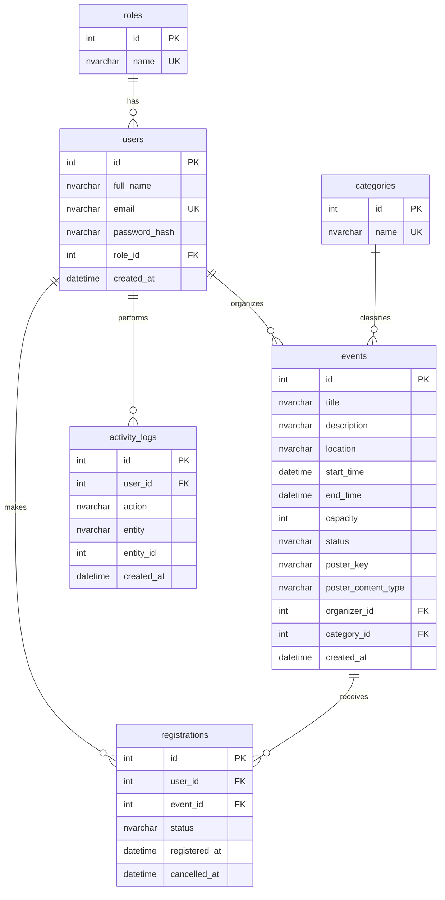

# Database Design

## ER diagram

Six tables. All times are stored as **UTC**.

## Why this is in Third Normal Form (3NF)
- Every table has a single-column primary key, and every other column describes *only* that key (no partial dependencies).
- Role names and category names live in `roles` / `categories`, so "organizer" or "Workshop" is stored once, not repeated on every row (no transitive dependencies).
- The number of registrations is **not stored** on `events`. It is calculated from `registrations`, so it can never get out of sync.
- `registrations` is the many-to-many link between users and events, with its own facts (status, timestamps).

## Constraints
| Table | Constraint |
|---|---|
| all | `PRIMARY KEY (id)` |
| users | `UNIQUE (email)`, `NOT NULL` on every column, `FK role_id -> roles` |
| roles / categories | `UNIQUE (name)` |
| events | `CHECK capacity > 0`, `CHECK end_time > start_time`, `CHECK status IN ('published','cancelled')`, `FK organizer_id -> users`, `FK category_id -> categories` |
| registrations | **`UNIQUE (user_id, event_id)`** (stops duplicate registrations even under race conditions), `CHECK status IN ('registered','cancelled')`, FKs to users and events |
| activity_logs | `FK user_id -> users` (nullable) |

Cancelling a registration changes `status` to `cancelled` (history is kept). Registering again re-uses the same row, which keeps the unique constraint simple.

## Indexes
`ix_events_start_time`, `ix_events_category_id`, `ix_events_organizer_id`, `ix_registrations_event_id`, `ix_activity_logs_created_at`, plus the automatic indexes behind every PK/UNIQUE constraint (`email`, `(user_id, event_id)`, names).

## View, trigger, transaction
| Object | Purpose | Where used |
|---|---|---|
| **View `vw_event_stats`** | Joins `events` + `categories` + `registrations` and counts registered/cancelled per event | `GET /api/analytics/organizer` queries it directly |
| **Trigger `trg_registrations_capacity`** | The database itself refuses to let an event exceed its capacity, even for writes that bypass the API | Fires on every INSERT/UPDATE of `registrations`. The API turns the error into HTTP 409 "event is full" |
| **Transaction** | Registering = lock event row, validate, insert/reactivate, write audit log, commit. All-or-nothing | `POST /api/events/{id}/register` (`routers/registrations.py`) |

## SQL joins used by the real application
- Event list/detail: `events` JOIN `categories`, JOIN `users` (organizer), LEFT JOIN a grouped count of `registrations` (`services/events.py`).
- My registrations: `registrations` JOIN `events`.
- Attendee list: `registrations` JOIN `users`.
- Analytics view: `events` JOIN `categories` LEFT JOIN `registrations`.

Reference T-SQL versions are in `database/sqlserver/05_example_queries.sql`.

## Two dialects, one design
The local development database is **SQLite**; the final target is **SQL Server / Azure SQL**. They are not equivalent.

| | SQLite (dev/tests) | SQL Server (Azure) |
|---|---|---|
| Schema | created by SQLAlchemy | `database/sqlserver/01_schema.sql` (generated from the same models) |
| View | `CREATE VIEW` (Python string in `db_objects.py`) | `02_view.sql` (`CREATE OR ALTER VIEW`) |
| Trigger | two `BEFORE` triggers using `RAISE(ABORT)` | `03_trigger.sql` (`AFTER INSERT, UPDATE`, `THROW`, row lock hint) |
| Row lock in register | ignored by SQLite | `WITH (UPDLOCK, ROWLOCK)` |

**Verification status:** the SQLite versions are tested. The SQL Server scripts were generated/compiled with SQLAlchemy's SQL Server dialect but have **never been executed on a real SQL Server** (none was available while building). See README "Verify on SQL Server" for the one-command test.

## Script order (SQL Server)
`01_schema.sql` → `02_view.sql` → `03_trigger.sql` → `04_seed_lookups.sql`. Each contains `GO` batch separators (use Azure Data Studio, SSMS or `sqlcmd`). Regenerate them after changing the models: `python database/generate_sqlserver_schema.py`.
