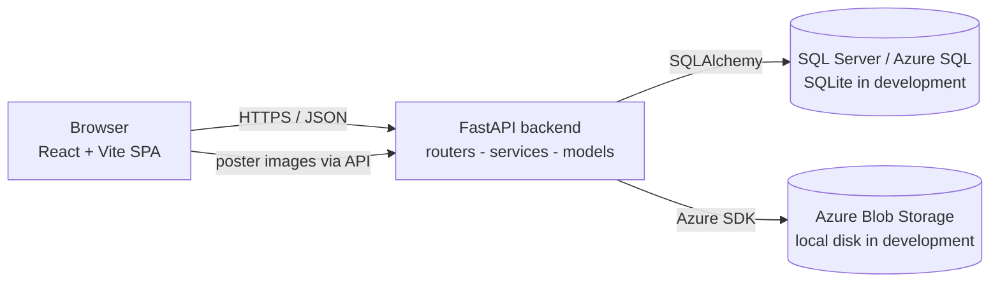

# System Design

## 1. Requirements

### Functional
| ID | Requirement |
|---|---|
| FR1 | Users register and log in; passwords are hashed; roles are participant and organizer |
| FR2 | Anyone can browse events, search by text and filter by category, and view event details |
| FR3 | Organizers create, edit and cancel their own events (never other organizers' events) |
| FR4 | Participants register for events, view and cancel their registrations; no duplicates; full/cancelled/started events are refused |
| FR5 | Organizers upload a poster image per event, stored in Azure Blob Storage (or local disk in development) |
| FR6 | Organizers see analytics computed from saved data |
| FR7 | Important actions are written to an activity log |

### Non-functional
| ID | Requirement | How it is met |
|---|---|---|
| NFR1 Security | Safe credentials, hashed passwords, access control | bcrypt, JWT, role checks on the server, secrets only in environment variables |
| NFR2 Integrity | No duplicate or over-capacity registrations, even with simultaneous clicks | Unique constraint + capacity trigger + row lock + transaction |
| NFR3 Usability | Responsive, accessible UI with clear states | Loading/empty/error states, labelled forms, keyboard focus styles, skip link |
| NFR4 Maintainability | One student can understand it | Modular monolith, one language per tier, small files |
| NFR5 Cost | Free tools by default | SQLite locally; Azure free offers where they exist (see deployment guide) |
| NFR6 Testability | Core rules covered by automated tests | 58 backend tests + 9 UI tests |

## 2. Architecture

### Data flow: "register for an event"
1. The participant clicks **Register now**; the React page calls `POST /api/events/{id}/register` with the JWT in the `Authorization` header.
2. FastAPI decodes the token, **re-reads the user and role from the database**, and requires the participant role.
3. In one transaction the API locks the event row, checks it is published, not started and not full, and inserts (or reactivates) the registration and an audit-log row.
4. The `UNIQUE (user_id, event_id)` constraint and the capacity trigger are the last line of defence; violations are returned as HTTP 409.
5. The page shows a success or error message and reloads the event, whose counts are recalculated from `registrations`.

### Responsibilities
| Layer | Responsibility |
|---|---|
| Frontend (React) | Rendering, client-side form checks (for convenience only), calling the API, showing loading/error/empty states. Never trusted for security. |
| Backend (FastAPI) | Authentication, authorization, validation, business rules, transactions, file handling, error handling, logging |
| Database | Persistence, integrity (keys, checks, unique, trigger), the analytics view |
| Blob storage | Poster files. The container is **private**; posters are served through the API |

### Backend modules
`config.py` settings · `database.py` engine · `models.py` tables · `schemas.py` validation · `security.py` hashing/JWT · `deps.py` auth dependencies · `routers/` HTTP endpoints · `services/` storage, events queries, activity log · `db_objects.py` view/trigger/lookups · `seed.py` demo data.

## 3. Why a modular monolith
One deployable backend with clearly separated modules is the right size here: a single student, one team, a small and tightly related domain (users, events, registrations), one database, and no need to scale parts independently. Microservices would add networking, deployment and data-consistency problems (e.g. registering atomically across services) with no benefit. Because the code is organised in modules, any part could be extracted later if needed.

## 4. Design trade-offs
1. **Derived counts vs a stored counter.** `registered_count` is calculated from `registrations` instead of stored on `events`. Slightly more work per read (mitigated by an index), but it can never drift and keeps the schema in 3NF.
2. **Cancel = status change, not DELETE.** Keeps history for analytics and lets the unique constraint stay simple, at the cost of a re-registration reusing the old row.
3. **Capacity enforced in three places** (row lock + application check + trigger). Redundant on purpose: the lock gives clean errors, the trigger protects against any writer that bypasses the API.
4. **JWT in `localStorage`.** Simple and works across the static front-end and separate API domain, but a successful XSS attack could read it. Mitigations: React escapes all output, no `dangerouslySetInnerHTML`, a strict Content-Security-Policy on the static host, 60-minute token lifetime. httpOnly cookies + CSRF protection would be the stronger (but more complex) alternative.
5. **SQLite locally, SQL Server in the cloud.** Zero setup for learning, but dialect differences exist (see DATABASE_DESIGN.md). Mitigated by keeping SQL Server objects as separate scripts and an opt-in test run against a real SQL Server.
6. **Self-selected organizer role at sign-up.** Appropriate for a student project; a real deployment would require organizer approval.

## 5. Security summary
bcrypt password hashing · JWT with server-side role lookup (forged role claims are ignored; tested) · ownership checks on every event-modifying endpoint · Pydantic validation on all input · SQLAlchemy parameterised queries (search text with `'` `%` `_` tested) · React output escaping · upload checks by file **content**, size limit, random filenames, `nosniff` · CORS limited to configured origins, no wildcard (startup fails in production if misconfigured) · generic 500 errors with details only in server logs · same error for unknown email and wrong password · activity log · security headers · HTTPS/HSTS in production · secrets only from environment variables.

## 6. Known limitations
No password reset or email verification · no rate limiting on login · no database migration tool (schema changes need manual SQL; Alembic is the natural next step) · no waiting list · event times are shown in each viewer's local time zone.
